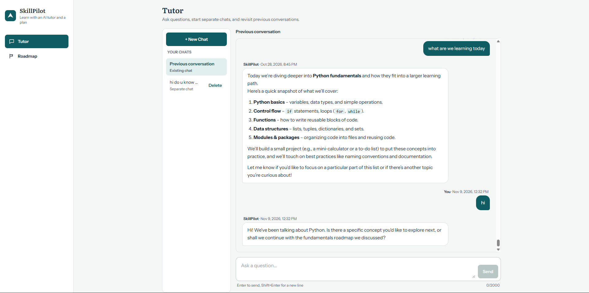
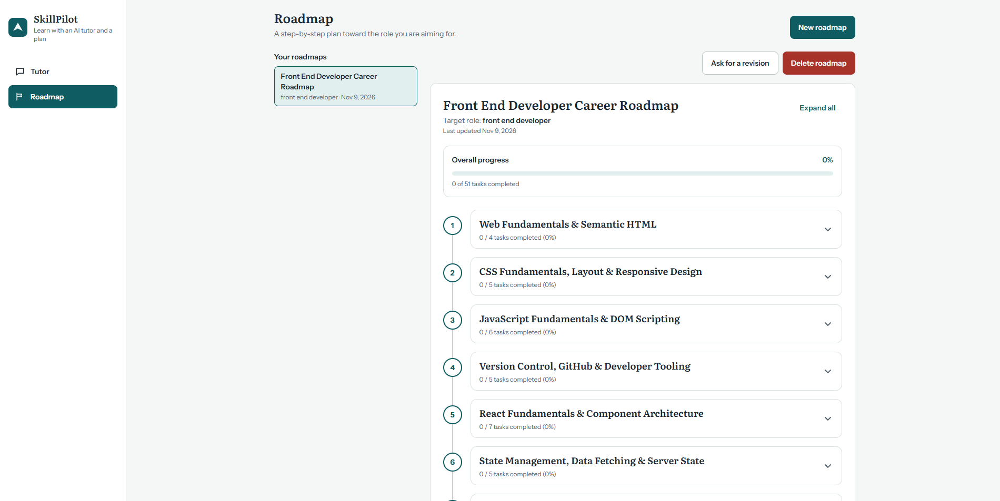
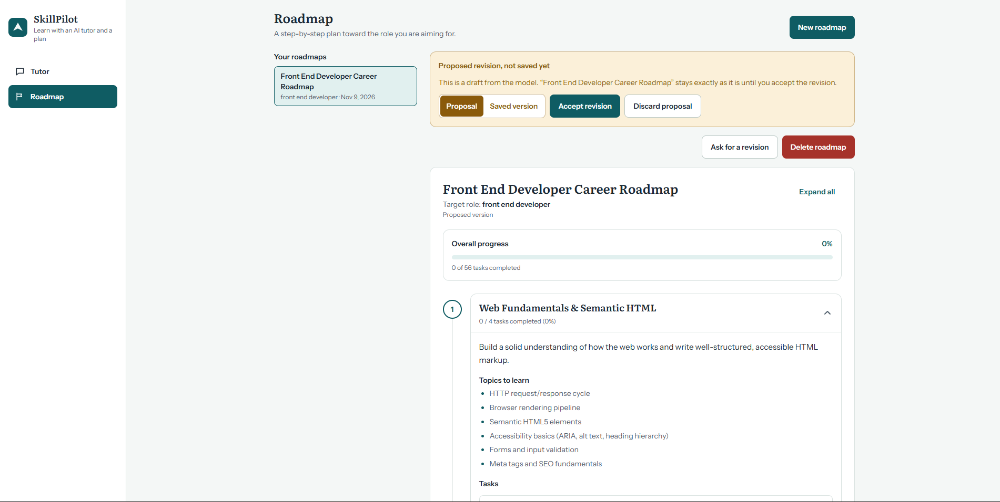

# SkillPilot – AI-Powered Learning Assistant

**Learn smarter. Build skills. Plan your career.**

SkillPilot is an AI-powered learning assistant designed to help students and beginners learn technical concepts, create personalized learning roadmaps, and maintain learning progress.

The project combines Large Language Models (LLMs), Retrieval-Augmented Generation (RAG), semantic search, and a modern web interface to provide an interactive learning experience.

---

## 1. Project Overview

Learning a new technical skill can be challenging. Students often struggle with:

- Knowing where to start.
- Understanding complex technical concepts.
- Creating a structured learning plan.
- Finding relevant information from previous learning sessions.
- Revising and organizing their learning roadmaps.

SkillPilot aims to address these challenges through an AI-powered learning platform.

The application provides an AI tutor, personalized learning roadmaps, and contextual conversation retrieval using embeddings and vector search.

## 2. Features

### 2.1 AI Tutor

An interactive AI-powered tutor that helps students understand technical concepts.

Capabilities:
- Ask questions about programming and technical subjects.
- Receive explanations in a conversational format.
- Maintain conversation history.
- Retrieve relevant previous messages using semantic search.
- Use embeddings to improve contextual retrieval.

### 2.2 Personalized Learning Roadmaps

Generate structured learning roadmaps based on a student's learning goals.

Capabilities:
- Generate learning roadmaps.
- Organize learning into structured stages.
- Revise existing roadmaps.
- Store and retrieve roadmap information.

### 2.3 Retrieval-Augmented Generation (RAG)

SkillPilot uses a RAG-based approach to retrieve relevant information from stored conversations.

The retrieval process includes:

1. Convert messages into vector embeddings.
2. Store embeddings in PostgreSQL using pgvector.
3. Convert a new question into an embedding.
4. Perform semantic similarity search.
5. Retrieve relevant conversation context.
6. Provide the retrieved context to the language model.

### 2.4 Conversation Context Management

The application stores tutor messages and uses semantic retrieval to find relevant historical context.

This helps avoid relying exclusively on a long conversation history when answering new questions.

---

## 3. Application Screenshots

### AI Tutor

The AI Tutor provides an interactive learning experience
where students can ask questions and receive AI-generated explanations.



### Learning Roadmap

Generate and explore structured learning roadmaps
based on individual learning goals.



### Roadmap Revision

Revise an existing learning roadmap based on updated
learning requirements.
        


---

## 4. Technology Stack

### Backend

- Python 3.11+
- FastAPI
- Pydantic
- PostgreSQL
- pgvector
- Ollama
- NVIDIA NIM API

### Frontend

- React
- TypeScript
- Vite
- React Router
- React Markdown

### AI and Retrieval

- Large Language Models (LLMs)
- Text Embeddings
- Retrieval-Augmented Generation (RAG)
- Semantic Search
- Vector Similarity Search

### Development Tools

- Visual Studio Code
- Git and GitHub
- PostgreSQL
- Ollama
- Pytest

---

## 5. System Architecture

The application follows a frontend-backend architecture.

```text
                  USER
                    |
                    v
             REACT FRONTEND
                    |
                    v
                FASTAPI
                    |
          +---------+---------+
          |                   |
          v                   v
      API ROUTES          SERVICES
          |                   |
          |           +-------+-------+
          |           |               |
          v           v               v
       SCHEMAS      LLM SERVICE   EMBEDDING SERVICE
                          |               |
                          v               v
                    NVIDIA NIM       OLLAMA
                                          |
                                          v
                                     EMBEDDINGS
                                          |
                                          v
                                    POSTGRESQL
                                      + pgvector
```

The frontend communicates with the FastAPI backend through API requests.

The backend handles application logic, AI model communication, database operations, and semantic retrieval.

---

## 6. Project Structure

```text
SkillPilot/
│
├── app/
│   ├── api/
│   │   └── routes/
│   │       ├── roadmap.py
│   │       ├── students.py
│   │       ├── system.py
│   │       └── tutor.py
│   │
│   ├── core/
│   │   └── config.py
│   │
│   ├── db/
│   │   ├── migrations/
│   │   │   ├── 001_initial_schema.sql
│   │   │   ├── 002_allow_multiple_roadmaps.sql
│   │   │   └── 003_tutor_messages_and_embeddings.sql
│   │   ├── connection.py
│   │   └── models.py
│   │
│   ├── models/
│   ├── schemas/
│   ├── services/
│   │   ├── embeddings.py
│   │   ├── roadmap.py
│   │   └── tutor.py
│   │
│   └── main.py
│
├── frontend/
│   ├── public/
│   └── src/
│       ├── api/
│       ├── components/
│       ├── lib/
│       ├── pages/
│       ├── App.tsx
│       ├── index.css
│       └── main.tsx
│
├── tests/
│   ├── test_api.py
│   ├── test_embeddings.py
│   └── test_tutor_service.py
│
├── .env.example
├── .gitignore
├── pytest.ini
├── requirements.txt
└── README.md
```

---

## 7. Prerequisites

Install the following software:

| Software | Requirement |
|---|---|
| Python | 3.11 or later |
| Node.js | Compatible with the installed Vite version |
| npm | Included with Node.js |
| PostgreSQL | With pgvector extension |
| Ollama | For local embedding generation |
| NVIDIA API key | For NVIDIA model access |
| Git | For version control |

---

## 8. Installation and Setup

### Step 1: Clone the repository

```bash
git clone https://github.com/Prithvikalyan/SkillPilot.git
cd SkillPilot
```

### Step 2: Create a Python virtual environment

Windows PowerShell:

```powershell
python -m venv .venv
```

Activate it:

```powershell
.venv\Scripts\Activate.ps1
```

### Step 3: Install backend dependencies

```powershell
pip install -r requirements.txt
```

### Step 4: Configure environment variables

Create a local `.env` file:

```powershell
Copy-Item .env.example .env
```

Update the database credentials and NVIDIA API key in `.env`.

**Never upload your actual `.env` file to GitHub.**

### Step 5: Configure PostgreSQL

1. Install and start PostgreSQL.
2. Create a database for SkillPilot.
3. Ensure pgvector is installed and enabled.
4. Execute the SQL migration files in numerical order.

The migration files are located at:

```text
app/db/migrations/
```

Run migrations in this order:

```text
001_initial_schema.sql
002_allow_multiple_roadmaps.sql
003_tutor_messages_and_embeddings.sql
```

### Step 6: Configure Ollama

Install Ollama and pull the embedding model:

```powershell
ollama pull nomic-embed-text
```

Ensure Ollama is running locally.

### Step 7: Start the backend

From the project root:

```powershell
uvicorn app.main:app --reload
```

Backend URL:

http://localhost:8000

FastAPI Swagger documentation:

http://localhost:8000/docs

### Step 8: Start the frontend

Open another terminal:

```powershell
cd frontend
npm install
npm run dev
```

Frontend URL:

http://localhost:5173

---

## 9. Environment Variables

The application uses environment variables for database connectivity and AI model configuration.

| Variable | Description |
|---|---|
| DATABASE_HOST | PostgreSQL host |
| DATABASE_PORT | PostgreSQL port |
| DATABASE_NAME | Database name |
| DATABASE_USER | Database username |
| DATABASE_PASSWORD | Database password |
| OLLAMA_BASE_URL | Local Ollama API URL |
| OLLAMA_MODEL | Configured Ollama model |
| ROADMAP_LLM_PROVIDER | Provider selected for roadmap generation |
| NVIDIA_API_KEY | NVIDIA API key |
| NVIDIA_BASE_URL | NVIDIA API base URL |
| NVIDIA_MODEL | NVIDIA model identifier |

Refer to `.env.example` for example configuration values.

---

## 10. Running Tests

Run the backend tests from the project root:

```powershell
pytest
```

The test suite includes API, tutor service, and embedding-related tests.

---

## 11. API Documentation

SkillPilot uses FastAPI for its backend.

After starting the backend, access:

- Swagger UI: http://localhost:8000/docs
- ReDoc: http://localhost:8000/redoc

These interfaces allow you to inspect and test the available API endpoints.

---

## 12. Future Improvements

Potential future enhancements include:

- Interactive quizzes and exercises.
- Student learning progress tracking.
- Career guidance and skill recommendations.
- Additional AI tools and function calling.
- More advanced retrieval and reranking.
- Agent-based workflows.
- Learning resource recommendations.

These are potential improvements, not claims that all features are currently implemented.

---

## 13. Security

- API keys and passwords must remain in local environment files.
- Never commit `.env` files.
- Do not commit virtual environments or dependency folders.
- Keep credentials out of source code and GitHub commits.

---

## 14. Project Status

SkillPilot is under active development.

The project is being developed incrementally, with a focus on practical AI application development, backend engineering, database integration, and retrieval-augmented generation.

---

## 15. Author

**SkillPilot**

GitHub Repository: https://github.com/Prithvikalyan/SkillPilot

---

*Built as a practical project to explore AI-powered learning applications, LLM integration, RAG, and full-stack development.*